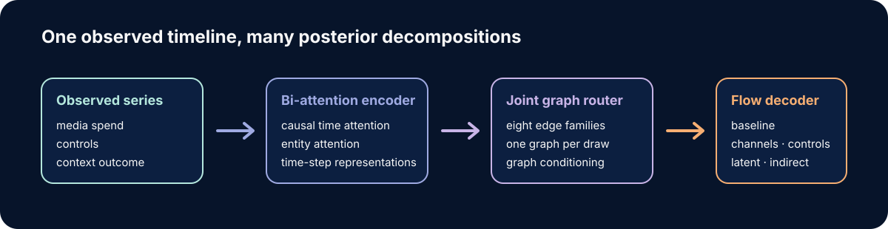

## Amortized inference

PyMC MFM learns an inference procedure from simulated worlds rather than fitting a new model to each observed dataset. Training teaches one network to map an observed history and query covariates to decomposition draws. Calling `inference` on a loaded [MFM](../reference/model.MFM.qmd) replaces its stored history, column roles and run; it does not optimize model weights.

## Context and query windows

The context window contains known outcomes. The query window follows it at the same cadence and supplies media spend and controls; query outcomes are not read. The model produces a marginal distribution for each window.

::: {.callout-note}
## Separate marginals

Context and query draws are not paired full-horizon trajectories. Equal draw indices across the two windows do not identify a joint draw, so do not concatenate their date axes to create one.
:::

## Inference path

{fig-alt="Observed regularly spaced media spend, controls, and context outcomes enter a bi-attention encoder. A joint graph router samples a causal graph, which conditions a rectified-flow decoder that returns posterior component draws."}

The three stages have separate jobs:

1. **Bi-attention encoder.** The encoder represents a cell grid with one token for each time step and media/control entity, plus a revenue cell. It attends causally over time within an entity and across entities at each time step. The shared projection and entity attention are permutation-equivariant.
2. **Joint graph router.** A joint flow routes over the eight edge families of the complete causal graph. The auxiliary structure head and graph conditioner use channel- and control-slot-equivariant scores and messages, so channel count is an observed input rather than an architecture constant.
3. **Graph-conditioned flow decoder.** A rectified flow decodes each time step's additive decomposition conditional on the sampled graph. Sampling transports draws through fixed-grid Euler steps.

## Causal graph

The router uses a flat layout of eight edge families. `K` is the number of channels, `M` is the configured control width, and `J` is the latent-demand width.

| Family | Edge direction | Slots |
| --- | --- | --- |
| `cy` | channel → outcome | `K` |
| `dc` | latent → channel | `J·K` |
| `dz` | latent → control | `J·M` |
| `dy` | latent → outcome | `J` |
| `zy` | control → outcome | `M` |
| `zc` | control → channel | `M·K` |
| `cc` | channel → channel, excluding self-loops | `K·(K-1)` |
| `zz` | control → control, excluding self-loops | `M·(M-1)` |

Choose graph treatment at inference time:

| Mode | Graph used for each decomposition draw |
| --- | --- |
| `model_average` | Sampled from the joint router; this is the default |
| `map` | The most frequent complete graph from router samples |
| `fixed` | A supplied binary graph hypothesis |

A fixed graph is a conditioning hypothesis, not posterior graph evidence or a causal-lift test.

## Posterior draws

[decompose](../reference/inference.decompose.qmd) returns aligned component and graph draws. Components have shape `[S, T_window, D]`; graphs have shape `[S, L]`; `S` is the number of draws and `L` is the number of graph slots. The component axis contains one baseline, `K` channel contributions, `M` control contributions, one latent total, and indirect `cc`, `zc`, and `dc` totals. Therefore `D = K + M + 5`.

Component values are in outcome units and exclude observation noise. A graph and its components share a draw index within a result.

## Units, padding, and masks

Each observed series is rescaled from context-window statistics before feature construction: context outcomes set the outcome scale, channels use context spend statistics, and controls use context statistics. Query inputs use those same scales. This makes the interface unit-agnostic while rejecting a column that is zero in context and nonzero in query.

Control width belongs to the model configuration, so dataframe controls are padded automatically and masks identify represented slots. Array callers can mask padded channels, controls, and latent slots explicitly. Raw results retain padded positions under component and edge masks, while sampling skips their non-live coordinate work and DataTree exports omit inactive slots. Padding is not an estimate that a represented feature is causally inactive. Channels are not padded to a fixed architecture width, which is why a model can accept different channel counts.
