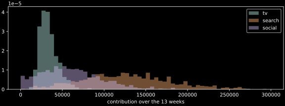
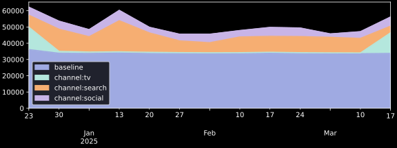

---
# What search results and link previews show; the page itself opens on the hero.
pagetitle: "PyMC MFM: Open-Source Marketing Foundational Models in Python"
description: "Open-source Python library for Marketing Foundational Models by PyMC Labs. Get each channel's contribution to sales with uncertainty, without refitting."
page-layout: custom
title-block-style: none
toc: false
section-divs: false
anchor-sections: false
body-classes: mfm-landing
css:
  - assets/styles/landing.css
  - assets/styles/tiles-scene.css
# Structured data for search engines: what the library is and who makes it.
include-in-header:
  text: |
    <script type="application/ld+json">
    {
      "@context": "https://schema.org",
      "@type": "SoftwareSourceCode",
      "name": "PyMC MFM",
      "alternateName": "PyMC Marketing Foundational Models",
      "description": "Marketing Foundational Models (MFM) are pretrained media mix models. An MFM reads weekly sales, spend and controls and returns each channel's contribution with an uncertainty range, without fitting a new model per dataset.",
      "codeRepository": "https://github.com/pymc-labs/pymc-mfm",
      "programmingLanguage": "Python",
      "keywords": ["marketing foundational model", "media mix modeling", "marketing mix modeling", "Bayesian", "amortized inference", "PyMC"],
      "author": {"@type": "Organization", "name": "PyMC Labs", "url": "https://www.pymc-labs.com"}
    }
    </script>
---

```{=html}
<script>
  // Hides the hero until landing.js plays the intro; a CSS fallback reveals it anyway.
  if (!matchMedia("(prefers-reduced-motion: reduce)").matches) document.documentElement.classList.add("mfm-intro");
</script>
<div class="mfm">

<!-- 1. Hero: one name, one line. Button icons: Phosphor Regular (assets/icons/phosphor). -->
<section class="mfm-hero" aria-labelledby="mfm-hero-title">
  <canvas class="mfm-hero__field" data-mfm="field" aria-hidden="true"></canvas>
  <div class="mfm-grain" aria-hidden="true"></div>
  <div class="mfm-hero__copy">
    
    <!-- The line wraps to the width of the name (landing.css). Every few seconds the first word
         glitches into "Bayesian" and back (landing.js). -->
    <div class="mfm-hero__name" data-mfm="name">
      <h1 id="mfm-hero-title" class="mfm-hero__title" aria-label="PyMC MFM"><span class="mfm-hero__word mfm-glitch" data-mfm="glitch" data-text="PyMC" aria-hidden="true">PyMC</span> <span class="mfm-hero__word" aria-hidden="true">MFM</span></h1>
      <p class="mfm-hero__line">Marketing foundational models by PyMC&nbsp;Labs.<br>Train once, decompose many.</p>
    </div>
    <div class="mfm-hero__actions">
      <a class="mfm-btn mfm-btn--primary" href="guide/index.html">Get started <svg class="mfm-btn__arrow" aria-hidden="true" focusable="false" viewBox="0 0 256 256" fill="currentColor"><path d="M221.66,133.66l-72,72a8,8,0,0,1-11.32-11.32L196.69,136H40a8,8,0,0,1,0-16H196.69L138.34,61.66a8,8,0,0,1,11.32-11.32l72,72A8,8,0,0,1,221.66,133.66Z"/></svg></a>
      <a class="mfm-btn mfm-btn--ghost" href="https://github.com/pymc-labs/pymc-mfm">
        <svg class="mfm-btn__icon" aria-hidden="true" focusable="false" viewBox="0 0 256 256" fill="currentColor"><path d="M208.31,75.68A59.78,59.78,0,0,0,202.93,28,8,8,0,0,0,196,24a59.75,59.75,0,0,0-48,24H124A59.75,59.75,0,0,0,76,24a8,8,0,0,0-6.93,4,59.78,59.78,0,0,0-5.38,47.68A58.14,58.14,0,0,0,56,104v8a56.06,56.06,0,0,0,48.44,55.47A39.8,39.8,0,0,0,96,192v8H72a24,24,0,0,1-24-24A40,40,0,0,0,8,136a8,8,0,0,0,0,16,24,24,0,0,1,24,24,40,40,0,0,0,40,40H96v16a8,8,0,0,0,16,0V192a24,24,0,0,1,48,0v40a8,8,0,0,0,16,0V192a39.8,39.8,0,0,0-8.44-24.53A56.06,56.06,0,0,0,216,112v-8A58.14,58.14,0,0,0,208.31,75.68ZM200,112a40,40,0,0,1-40,40H112a40,40,0,0,1-40-40v-8a41.74,41.74,0,0,1,6.9-22.48A8,8,0,0,0,80,73.83a43.81,43.81,0,0,1,.79-33.58,43.88,43.88,0,0,1,32.32,20.06A8,8,0,0,0,119.82,64h32.35a8,8,0,0,0,6.74-3.69,43.87,43.87,0,0,1,32.32-20.06A43.81,43.81,0,0,1,192,73.83a8.09,8.09,0,0,0,1,7.65A41.72,41.72,0,0,1,200,104Z"/></svg>
        GitHub <svg class="mfm-btn__arrow" aria-hidden="true" focusable="false" viewBox="0 0 256 256" fill="currentColor"><path d="M200,64V168a8,8,0,0,1-16,0V83.31L69.66,197.66a8,8,0,0,1-11.32-11.32L172.69,72H88a8,8,0,0,1,0-16H192A8,8,0,0,1,200,64Z"/></svg>
      </a>
    </div>
  </div>
</section>

<!-- 2. The library at work, one scroll below the hero: the claim, a line under it and the
     two ways to PyMC Labs, centred over a notebook in an editor ----------------------- -->
<section class="mfm-show" aria-labelledby="mfm-show-title">
  <header class="mfm-show__head mfm-claim mfm-reveal">
    <h2 id="mfm-show-title">Your next media mix model is already trained.</h2>
    <p>Decisions shouldn't wait months for a model to be built. MFM gets you to answers
      in seconds, and PyMC&nbsp;Labs works with you to get there.</p>
    <div class="mfm-claim__actions">
      <a class="mfm-btn mfm-btn--primary" href="https://www.pymc-labs.com/contact">Contact us <svg class="mfm-btn__arrow" aria-hidden="true" focusable="false" viewBox="0 0 256 256" fill="currentColor"><path d="M200,64V168a8,8,0,0,1-16,0V83.31L69.66,197.66a8,8,0,0,1-11.32-11.32L172.69,72H88a8,8,0,0,1,0-16H192A8,8,0,0,1,200,64Z"/></svg></a>
      <a class="mfm-btn mfm-btn--ghost" href="https://www.pymc-labs.com/white-papers/marketing-foundation-models#get-paper">Get the white paper <svg class="mfm-btn__arrow" aria-hidden="true" focusable="false" viewBox="0 0 256 256" fill="currentColor"><path d="M200,64V168a8,8,0,0,1-16,0V83.31L69.66,197.66a8,8,0,0,1-11.32-11.32L172.69,72H88a8,8,0,0,1,0-16H192A8,8,0,0,1,200,64Z"/></svg></a>
    </div>
  </header>

  <figure class="mfm-stage mfm-reveal" aria-label="A Jupyter notebook in a code editor. It reads weekly sales with pandas, loads River 1.0, forecasts the contributions of the last 13 weeks as 1,000 posterior draws, conditioned on the history plus those weeks' spend and promo control but not their sales, exports an ArviZ DataTree, summarises each channel's total contribution, and plots its distribution, the weekly contributions with 90% intervals and the stacked mean decomposition. Synthetic data; the outputs come from River 1.0.">
    <div class="mfm-stage__bg" aria-hidden="true"><i></i><i></i><i></i><i></i></div>
    <div class="mfm-grain" aria-hidden="true"></div>

    <div class="mfm-ide" data-mfm="notebook" data-ui>
      <div class="mfm-ide__titlebar">
        <span class="mfm-ide__lights" aria-hidden="true"><i></i><i></i><i></i></span>
        <span class="mfm-ide__command"><svg viewBox="0 0 16 16" aria-hidden="true"><circle cx="7" cy="7" r="4.5"/><path d="M10.5 10.5 14 14"/></svg>pymc-mfm</span>
      </div>

      <div class="mfm-ide__body">
        <nav class="mfm-ide__activity" aria-hidden="true">
          <svg class="is-active" viewBox="0 0 24 24"><path d="M14 3H7a2 2 0 0 0-2 2v14a2 2 0 0 0 2 2h10a2 2 0 0 0 2-2V8z"/><path d="M14 3v5h5"/></svg>
          <svg viewBox="0 0 24 24"><circle cx="10.5" cy="10.5" r="6.5"/><path d="m15.5 15.5 5 5"/></svg>
          <svg viewBox="0 0 24 24"><circle cx="6" cy="5" r="2"/><circle cx="6" cy="19" r="2"/><circle cx="18" cy="9" r="2"/><path d="M6 7v10M18 11c0 4-6 3-11 7"/></svg>
          <svg viewBox="0 0 24 24"><path d="M7 4v16l13-8z"/></svg>
          <svg viewBox="0 0 24 24"><rect x="3" y="3" width="7" height="7"/><rect x="14" y="3" width="7" height="7"/><rect x="3" y="14" width="7" height="7"/><rect x="14" y="14" width="7" height="7"/></svg>
        </nav>

        <aside class="mfm-ide__explorer" aria-hidden="true">
          <p class="mfm-ide__explorer-title">Explorer</p>
          <ul>
            <li class="is-folder">pymc-mfm</li>
            <li class="is-folder is-l1">data</li>
            <li class="is-l2 is-csv">weekly_sales.csv</li>
            <li class="is-l1 is-ipynb is-active">quickstart.ipynb</li>
            <li class="is-l1 is-toml">pyproject.toml</li>
            <li class="is-l1 is-md">README.md</li>
          </ul>
        </aside>

        <div class="mfm-ide__editor">
          <div class="mfm-ide__tabs">
            <span class="mfm-ide__tab is-active"><i class="is-ipynb"></i>quickstart.ipynb</span>
            <span class="mfm-ide__tab"><i class="is-csv"></i>weekly_sales.csv</span>
          </div>
          <div class="mfm-ide__toolbar">
            <span>+ Code</span>
            <span>+ Markdown</span>
            <button class="mfm-ide__runall" type="button" data-mfm="run-all"><svg viewBox="0 0 16 16" aria-hidden="true"><path d="M4 2.5v11l9-5.5z"/></svg>Run All</button>
            <span class="mfm-ide__dim">Restart</span>
            <span class="mfm-ide__kernel">Python 3.13 (.venv)</span>
          </div>

          <div class="mfm-ide__cells" data-mfm="cells">
<div class="mfm-cell" data-duration="900">
  <div class="mfm-cell__gutter"><span class="mfm-cell__count">[1]</span></div>
  <div class="mfm-cell__main">
    <div class="mfm-cell__box">
      <span class="mfm-cell__bar" aria-hidden="true"></span>
<pre class="mfm-cell__code"><code><span class="k">import</span> <span class="m">arviz_stats</span> <span class="k">as</span> <span class="m">azs</span>
<span class="k">import</span> <span class="m">matplotlib.pyplot</span> <span class="k">as</span> <span class="m">plt</span>
<span class="k">import</span> <span class="m">numpy</span> <span class="k">as</span> <span class="m">np</span>
<span class="k">import</span> <span class="m">pandas</span> <span class="k">as</span> <span class="m">pd</span>
<span class="k">from</span> <span class="m">pymc_mfm</span> <span class="k">import</span> <span class="f">from_pretrained</span>

<span class="m">plt</span>.<span class="v">style</span>.<span class="f">use</span>(<span class="s">"dark_background"</span>)
<span class="m">plt</span>.<span class="v">rcParams</span>.<span class="f">update</span>({
    <span class="s">"axes.prop_cycle"</span>: <span class="m">plt</span>.<span class="f">cycler</span>(<span class="p">color</span><span class="o">=</span>[<span class="s">"#b4e7dd"</span>, <span class="s">"#f6ae72"</span>, <span class="s">"#c8b4e7"</span>]),
    <span class="s">"figure.constrained_layout.use"</span>: <span class="k">True</span>,
})

<span class="v">df</span> <span class="o">=</span> <span class="m">pd</span>.<span class="f">read_csv</span>(<span class="s">"data/weekly_sales.csv"</span>, <span class="p">parse_dates</span><span class="o">=</span>[<span class="s">"week"</span>])
<span class="v">df</span>.<span class="f">head</span>()</code></pre>
      <span class="mfm-cell__status" aria-hidden="true"></span>
    </div>
    <div class="mfm-cell__output">
      <table class="mfm-df">
        <thead><tr><th></th><th>week</th><th>tv</th><th>search</th><th>social</th><th>promo</th><th>sales</th></tr></thead>
        <tbody>
          <tr><th>0</th><td>2021-03-29</td><td>16300.0</td><td>1472.6</td><td>1215.5</td><td>0</td><td>52982.8</td></tr>
          <tr><th>1</th><td>2021-04-05</td><td>0.0</td><td>1357.7</td><td>763.9</td><td>0</td><td>39306.6</td></tr>
          <tr><th>2</th><td>2021-04-12</td><td>0.0</td><td>984.3</td><td>4291.7</td><td>0</td><td>48753.2</td></tr>
          <tr><th>3</th><td>2021-04-19</td><td>0.0</td><td>1329.7</td><td>4668.3</td><td>0</td><td>53429.6</td></tr>
          <tr><th>4</th><td>2021-04-26</td><td>0.0</td><td>1742.9</td><td>1149.4</td><td>0</td><td>45187.8</td></tr>
        </tbody>
      </table>
    </div>
  </div>
</div>

<div class="mfm-cell" data-duration="1600">
  <div class="mfm-cell__gutter"><span class="mfm-cell__count">[2]</span></div>
  <div class="mfm-cell__main">
    <div class="mfm-cell__box">
      <span class="mfm-cell__bar" aria-hidden="true"></span>
<pre class="mfm-cell__code"><code><span class="v">model</span> <span class="o">=</span> <span class="f">from_pretrained</span>(<span class="s">"pymc-labs/mfm"</span>, <span class="p">profile</span><span class="o">=</span><span class="s">"river-1"</span>)
<span class="v">history</span>, <span class="v">future</span> <span class="o">=</span> <span class="v">df</span>[:<span class="n">-13</span>], <span class="v">df</span>[<span class="n">-13</span>:]
<span class="v">roles</span> <span class="o">=</span> <span class="f">dict</span>(
    <span class="p">date_column</span><span class="o">=</span><span class="s">"week"</span>,
    <span class="p">target_column</span><span class="o">=</span><span class="s">"sales"</span>,
    <span class="p">channel_columns</span><span class="o">=</span>[<span class="s">"tv"</span>, <span class="s">"search"</span>, <span class="s">"social"</span>],
    <span class="p">control_columns</span><span class="o">=</span>[<span class="s">"promo"</span>],
)
<span class="v">usage</span> <span class="o">=</span> <span class="v">model</span>.<span class="f">input_usage</span>(<span class="v">history</span>, <span class="v">future</span>, <span class="o">**</span><span class="v">roles</span>)  <span class="c"># no sampling</span></code></pre>
      <span class="mfm-cell__status" aria-hidden="true"></span>
    </div>
  </div>
</div>

<div class="mfm-cell" data-duration="1800">
  <div class="mfm-cell__gutter"><span class="mfm-cell__count">[3]</span></div>
  <div class="mfm-cell__main">
    <div class="mfm-cell__box">
      <span class="mfm-cell__bar" aria-hidden="true"></span>
<pre class="mfm-cell__code"><code><span class="v">idata</span> <span class="o">=</span> <span class="v">model</span>.<span class="f">inference</span>(<span class="v">history</span>, <span class="v">future</span>, <span class="o">**</span><span class="v">roles</span>, <span class="p">n_samples</span><span class="o">=</span><span class="n">1_000</span>)
<span class="c"># River conditions on the history plus the query weeks' spend and promo,</span>
<span class="c"># not their sales. Weeks whose sales it conditioned on: idata["context"].</span>
<span class="c"># The query weeks' sales stay in idata["query/observed_data"] for comparison.</span>
<span class="v">query</span> <span class="o">=</span> <span class="v">model</span>.<span class="v">query_result</span>  <span class="c"># exact query draws for diagnostics and graphs</span>
<span class="v">query</span>.<span class="v">components</span>.<span class="v">shape</span>  <span class="c"># draws, weeks, components</span></code></pre>
      <span class="mfm-cell__status" aria-hidden="true"></span>
    </div>
    <div class="mfm-cell__output"><pre class="mfm-cell__text">(1000, 13, 18)</pre></div>
  </div>
</div>

<div class="mfm-cell" data-duration="1000">
  <div class="mfm-cell__gutter"><span class="mfm-cell__count">[4]</span></div>
  <div class="mfm-cell__main">
    <div class="mfm-cell__box">
      <span class="mfm-cell__bar" aria-hidden="true"></span>
<pre class="mfm-cell__code"><code><span class="k">assert</span> <span class="v">idata</span> <span class="k">is</span> <span class="v">model</span>.<span class="v">idata</span>  <span class="c"># complete context and query windows, stored automatically</span>
<span class="v">idata</span>[<span class="s">"query"</span>][<span class="s">"posterior"</span>]</code></pre>
      <span class="mfm-cell__status" aria-hidden="true"></span>
    </div>
    <div class="mfm-cell__output">
      <div class="mfm-xr">
        <p class="mfm-xr__head">xarray.DataTree <span>'posterior'</span></p>
        <p class="mfm-xr__sec">▸ Group: /query/posterior</p>
        <p class="mfm-xr__sec">▾ Dimensions: <span>(chain: 1, draw: 1000, date: 13, channel: 3, control: 1, edge: 18)</span></p>
        <p class="mfm-xr__sec">▸ Coordinates: <span>(6)</span></p>
        <p class="mfm-xr__sec">▾ Data variables:</p>
        <table class="mfm-xr__vars">
          <tr><th>channel_contribution</th><td>(chain, draw, date, channel)</td><td>float64</td><td>1.585e+04 ...</td></tr>
          <tr><th>control_contribution</th><td>(chain, draw, date, control)</td><td>float64</td><td>229.1 ...</td></tr>
          <tr><th>baseline</th><td>(chain, draw, date)</td><td>float64</td><td>2.608e+04 ...</td></tr>
          <tr><th>latent</th><td>(chain, draw, date)</td><td>float64</td><td>0.0 0.0 ...</td></tr>
          <tr><th>indirect_cc</th><td>(chain, draw, date)</td><td>float64</td><td>0.0 0.0 ...</td></tr>
          <tr><th>indirect_zc</th><td>(chain, draw, date)</td><td>float64</td><td>0.0 0.0 ...</td></tr>
          <tr><th>indirect_dc</th><td>(chain, draw, date)</td><td>float64</td><td>0.0 0.0 ...</td></tr>
          <tr><th>graph</th><td>(chain, draw, edge)</td><td>float32</td><td>1.0 1.0 ...</td></tr>
        </table>
        <p class="mfm-xr__sec">▸ Attributes: <span>(21)</span></p>
      </div>
    </div>
  </div>
</div>

<div class="mfm-cell" data-duration="700">
  <div class="mfm-cell__gutter"><span class="mfm-cell__count">[5]</span></div>
  <div class="mfm-cell__main">
    <div class="mfm-cell__box">
      <span class="mfm-cell__bar" aria-hidden="true"></span>
<pre class="mfm-cell__code"><code><span class="v">total</span> <span class="o">=</span> <span class="v">idata</span>[<span class="s">"query"</span>][<span class="s">"posterior"</span>][<span class="s">"channel_contribution"</span>].<span class="f">sum</span>(<span class="s">"date"</span>)
<span class="m">azs</span>.<span class="f">summary</span>(<span class="v">total</span>, <span class="p">kind</span><span class="o">=</span><span class="s">"stats"</span>)</code></pre>
      <span class="mfm-cell__status" aria-hidden="true"></span>
    </div>
    <div class="mfm-cell__output">
      <table class="mfm-df">
        <thead><tr><th></th><th>mean</th><th>sd</th><th>eti89_lb</th><th>eti89_ub</th></tr></thead>
        <tbody>
          <tr><th>channel_contribution[tv]</th><td>34000</td><td>11000</td><td>20000</td><td>52000</td></tr>
          <tr><th>channel_contribution[search]</th><td>130000</td><td>53000</td><td>46000</td><td>220000</td></tr>
          <tr><th>channel_contribution[social]</th><td>60000</td><td>36000</td><td>9100</td><td>120000</td></tr>
        </tbody>
      </table>
    </div>
  </div>
</div>

<div class="mfm-cell" data-duration="800">
  <div class="mfm-cell__gutter"><span class="mfm-cell__count">[6]</span></div>
  <div class="mfm-cell__main">
    <div class="mfm-cell__box">
      <span class="mfm-cell__bar" aria-hidden="true"></span>
<pre class="mfm-cell__code"><code><span class="v">fig</span>, <span class="v">ax</span> <span class="o">=</span> <span class="m">plt</span>.<span class="f">subplots</span>(<span class="p">figsize</span><span class="o">=</span>(<span class="n">8</span>, <span class="n">3</span>))
<span class="k">for</span> <span class="v">channel</span> <span class="k">in</span> <span class="v">total</span>.<span class="v">channel</span>.<span class="v">values</span>:
    <span class="v">ax</span>.<span class="f">hist</span>(<span class="v">total</span>.<span class="f">sel</span>(<span class="p">channel</span><span class="o">=</span><span class="v">channel</span>).<span class="v">values</span>.<span class="f">ravel</span>(), <span class="p">bins</span><span class="o">=</span><span class="n">60</span>, <span class="p">range</span><span class="o">=</span>(<span class="n">0</span>, <span class="n">3e5</span>),
            <span class="p">density</span><span class="o">=</span><span class="k">True</span>, <span class="p">histtype</span><span class="o">=</span><span class="s">"stepfilled"</span>, <span class="p">alpha</span><span class="o">=</span><span class="n">0.45</span>, <span class="p">label</span><span class="o">=</span><span class="v">channel</span>)
<span class="v">ax</span>.<span class="f">set_xlabel</span>(<span class="s">"contribution over the 13 weeks"</span>)
<span class="v">ax</span>.<span class="f">legend</span>()
<span class="m">plt</span>.<span class="f">show</span>()</code></pre>
      <span class="mfm-cell__status" aria-hidden="true"></span>
    </div>
    <div class="mfm-cell__output"></div>
  </div>
</div>

<div class="mfm-cell" data-duration="800">
  <div class="mfm-cell__gutter"><span class="mfm-cell__count">[7]</span></div>
  <div class="mfm-cell__main">
    <div class="mfm-cell__box">
      <span class="mfm-cell__bar" aria-hidden="true"></span>
<pre class="mfm-cell__code"><code><span class="v">names</span> <span class="o">=</span> <span class="t">list</span>(<span class="v">query</span>.<span class="v">component_names</span>)
<span class="v">fig</span>, <span class="v">ax</span> <span class="o">=</span> <span class="m">plt</span>.<span class="f">subplots</span>(<span class="p">figsize</span><span class="o">=</span>(<span class="n">8</span>, <span class="n">3</span>))
<span class="k">for</span> <span class="v">channel</span> <span class="k">in</span> [<span class="s">"tv"</span>, <span class="s">"search"</span>, <span class="s">"social"</span>]:
    <span class="v">draws</span> <span class="o">=</span> <span class="v">query</span>.<span class="v">components</span>[:, :, <span class="v">names</span>.<span class="f">index</span>(<span class="s">f"channel:</span>{<span class="v">channel</span>}<span class="s">"</span>)]
    <span class="v">low</span>, <span class="v">mid</span>, <span class="v">high</span> <span class="o">=</span> <span class="m">np</span>.<span class="f">quantile</span>(<span class="v">draws</span>, [<span class="n">0.05</span>, <span class="n">0.5</span>, <span class="n">0.95</span>], <span class="p">axis</span><span class="o">=</span><span class="n">0</span>)
    (<span class="v">line</span>,) <span class="o">=</span> <span class="v">ax</span>.<span class="f">plot</span>(<span class="v">query</span>.<span class="v">time</span>, <span class="v">mid</span>, <span class="p">label</span><span class="o">=</span><span class="v">channel</span>)
    <span class="v">ax</span>.<span class="f">fill_between</span>(<span class="v">query</span>.<span class="v">time</span>, <span class="v">low</span>, <span class="v">high</span>, <span class="p">color</span><span class="o">=</span><span class="v">line</span>.<span class="f">get_color</span>(), <span class="p">alpha</span><span class="o">=</span><span class="n">0.2</span>)
<span class="v">ax</span>.<span class="f">legend</span>()
<span class="m">plt</span>.<span class="f">show</span>()</code></pre>
      <span class="mfm-cell__status" aria-hidden="true"></span>
    </div>
    <div class="mfm-cell__output"></div>
  </div>
</div>

<div class="mfm-cell" data-duration="800">
  <div class="mfm-cell__gutter"><span class="mfm-cell__count">[8]</span></div>
  <div class="mfm-cell__main">
    <div class="mfm-cell__box">
      <span class="mfm-cell__bar" aria-hidden="true"></span>
<pre class="mfm-cell__code"><code><span class="v">mean</span> <span class="o">=</span> <span class="m">pd</span>.<span class="t">DataFrame</span>(<span class="v">query</span>.<span class="v">components</span>.<span class="f">mean</span>(<span class="p">axis</span><span class="o">=</span><span class="n">0</span>), <span class="p">index</span><span class="o">=</span><span class="v">query</span>.<span class="v">time</span>, <span class="p">columns</span><span class="o">=</span><span class="v">names</span>)
<span class="v">mean</span>[[<span class="s">"baseline"</span>, <span class="s">"channel:tv"</span>, <span class="s">"channel:search"</span>, <span class="s">"channel:social"</span>]].<span class="v">plot</span>.<span class="f">area</span>(
    <span class="p">figsize</span><span class="o">=</span>(<span class="n">8</span>, <span class="n">3</span>), <span class="p">color</span><span class="o">=</span>[<span class="s">"#9faae2"</span>, <span class="s">"#b4e7dd"</span>, <span class="s">"#f6ae72"</span>, <span class="s">"#c8b4e7"</span>]
)
<span class="m">plt</span>.<span class="f">show</span>()</code></pre>
      <span class="mfm-cell__status" aria-hidden="true"></span>
    </div>
    <div class="mfm-cell__output"></div>
  </div>
</div>
          </div>
        </div>
      </div>

      <div class="mfm-ide__statusbar" aria-hidden="true">
        <span>⎇ main</span>
        <span>0 errors, 0 warnings</span>
        <span class="mfm-ide__spacer"></span>
        <span data-mfm="cell-of">Cell 8 of 8</span>
        <span>Python 3.13.9 ('.venv')</span>
      </div>
    </div>
    <!-- Cell outputs come from running these cells with River 1.0 (pinned revision, torch
         seed 0) on a synthetic weekly dataset; the figures are the matplotlib SVGs. -->
  </figure>

  <div class="mfm-show__install mfm-reveal">
    <!-- The path for invited testers: the hosted River API and the Python client, no weights. -->
    <p class="mfm-show__testers">Invited testers: use the hosted River API from Python. <a href="guide/index.html#hosted-api">Start at Get started <svg class="mfm-arrow" aria-hidden="true" focusable="false" viewBox="0 0 256 256" fill="currentColor"><path d="M221.66,133.66l-72,72a8,8,0,0,1-11.32-11.32L196.69,136H40a8,8,0,0,1,0-16H196.69L138.34,61.66a8,8,0,0,1,11.32-11.32l72,72A8,8,0,0,1,221.66,133.66Z"/></svg></a></p>
    <p class="mfm-show__note">You don't need to install Python to use the browser console. The notebook above runs River 1.0 locally on synthetic data; that needs the River weights, which are shared by invitation. <a href="guide/examples/river_1_quickstart.html">Try the River quickstart <svg class="mfm-arrow" aria-hidden="true" focusable="false" viewBox="0 0 256 256" fill="currentColor"><path d="M221.66,133.66l-72,72a8,8,0,0,1-11.32-11.32L196.69,136H40a8,8,0,0,1,0-16H196.69L138.34,61.66a8,8,0,0,1,11.32-11.32l72,72A8,8,0,0,1,221.66,133.66Z"/></svg></a></p>
  </div>
</section>

<!-- 3. Why amortize. The section pins while you scroll and changes in place: Amortized,
     Causal, Bayesian, each word big in the middle of the screen with a wall of painted tiles
     behind it (tiles-scene.css, tiles-scene.js). Full width; sticky needs no ancestor that
     scrolls (.mfm clips, which is fine). ------------------------------------------------ -->
<section class="tiles-scene" aria-label="Amortized, causal, Bayesian">
  <div class="ts-pin">
    <div class="ts-text">
      <ol class="ts-steps" aria-hidden="true"><li class="is-on">01</li><li>02</li><li>03</li></ol>
      <div class="ts-copies">
        <div class="ts-copy is-on"><h2 class="ts-title">Amortized.</h2><p class="ts-line">Training is paid once, on simulated worlds with known answers. A new dataset is context, not a new fit: a thousand posterior draws in seconds, on a CPU.</p></div>
        <div class="ts-copy"><h2 class="ts-title">Causal.</h2><p class="ts-line">Every draw carries the causal graph it was sampled with, over channels, controls and latent demand. Average over graphs, take the most frequent one, or fix your own.</p></div>
        <div class="ts-copy"><h2 class="ts-title">Bayesian.</h2><p class="ts-line">Draws, not point estimates: each contribution in outcome units with its uncertainty, exported as an ArviZ DataTree for the rest of your PyMC workflow.</p></div>
      </div>
    </div>
    <div class="ts-wall"><canvas class="ts-canvas" aria-hidden="true"></canvas></div>
  </div>
</section>

<!-- 4. Questions, as a strip of cards that repeats both ways: landing.js copies the set
     onto each side, so the page itself holds each card once. All cards are one size; the
     one in the middle is filled in a matte aqua and the ones beside it show only their
     questions. Arrows on the line of the cards step one card, a mouse drags the strip,
     touch and trackpads scroll it, and a click on a side card brings it to the middle.
     Without JavaScript it scrolls sideways with every answer readable. The answers here
     and in the FAQPage data below are the same text: search engines show them as rich
     results only when they match what the page shows. The questions on Marketing
     Foundational Models, River, your data, budget decisions and PyMC-Marketing follow the
     white paper's FAQ (pymc-labs.com/white-papers/marketing-foundation-models); keep those
     in step. -->
<section class="mfm-section mfm-faq mfm-reveal" aria-labelledby="mfm-faq-title">
  <h2 class="mfm-faq__title" id="mfm-faq-title">Frequently Asked Questions</h2>
  <div class="mfm-faq__stage">
    <button class="mfm-faq__btn mfm-faq__btn--prev" type="button" data-mfm="faq-prev" aria-controls="mfm-faq-track" aria-label="Previous question"><svg aria-hidden="true" focusable="false" viewBox="0 0 256 256" fill="currentColor"><path d="M224,128a8,8,0,0,1-8,8H59.31l58.35,58.34a8,8,0,0,1-11.32,11.32l-72-72a8,8,0,0,1,0-11.32l72-72a8,8,0,0,1,11.32,11.32L59.31,120H216A8,8,0,0,1,224,128Z"/></svg></button>
    <ul class="mfm-faq__track" id="mfm-faq-track" data-mfm="faq">
      <li class="mfm-faq__card">
        <h3>What are Marketing Foundational Models?</h3>
        <p>Marketing Foundational Models (MFM) are pretrained media mix models. An MFM reads weekly sales, spend and controls and returns each channel's contribution with an uncertainty range, without fitting a new model per dataset.</p>
      </li>
      <li class="mfm-faq__card">
        <h3>What is PyMC MFM?</h3>
        <p>PyMC MFM is the Python library for <a href="https://www.pymc-labs.com/white-papers/marketing-foundation-models">Marketing Foundational Models</a>. Load a pretrained model such as River, add your weekly sales, spend and controls, and get each channel's contribution with an uncertainty range in seconds, with no model to fit.</p>
      </li>
      <li class="mfm-faq__card">
        <h3>What can PyMC MFM do?</h3>
        <p>It splits sales into baseline, channel and control contributions with intervals, in seconds and with no refit. Each draw shows the causal graph behind it, and results export as an ArviZ DataTree. Use the Python library or the River API, or train your own model on simulated marketing data.</p>
      </li>
      <li class="mfm-faq__card">
        <h3>What is River?</h3>
        <p>River is the first Marketing Foundational Model built by PyMC Labs. It was trained on simulated marketing worlds, models direct effects on sales, and is a research preview. <a href="models/river-1/index.html">Read River's release notes</a>.</p>
      </li>
      <li class="mfm-faq__card">
        <h3>Why choose PyMC MFM?</h3>
        <p>It comes from the team behind <a href="https://www.pymc-labs.com/open-source">PyMC, PyMC-Marketing and CausalPy</a>. The method, prior and limits are in the <a href="https://www.pymc-labs.com/white-papers/marketing-foundation-models">white paper</a>, and on 500 simulated datasets MFM split sales more accurately than standard regressions.</p>
      </li>
      <li class="mfm-faq__card">
        <h3>Does MFM need my data for training?</h3>
        <p>No. MFM is trained only on simulated marketing worlds. Your data is used only as context when it estimates contributions.</p>
      </li>
      <li class="mfm-faq__card">
        <h3>Can I use MFM for budget decisions today?</h3>
        <p>Yes, but with care. River has not been trained or tested on complex marketing scenarios, so there is a risk in taking decisions based on its simple understanding of marketing systems.</p>
      </li>
      <li class="mfm-faq__card">
        <h3>How is MFM different from PyMC-Marketing?</h3>
        <p>PyMC-Marketing is an open-source Python package for building Bayesian media mix models. With it, you fit a new model to each dataset. PyMC MFM is a separate package that reuses one pretrained model, so a new dataset needs no refit.</p>
      </li>
    </ul>
    <button class="mfm-faq__btn mfm-faq__btn--next" type="button" data-mfm="faq-next" aria-controls="mfm-faq-track" aria-label="Next question"><svg aria-hidden="true" focusable="false" viewBox="0 0 256 256" fill="currentColor"><path d="M221.66,133.66l-72,72a8,8,0,0,1-11.32-11.32L196.69,136H40a8,8,0,0,1,0-16H196.69L138.34,61.66a8,8,0,0,1,11.32-11.32l72,72A8,8,0,0,1,221.66,133.66Z"/></svg></button>
  </div>
<script type="application/ld+json">
{
  "@context": "https://schema.org",
  "@type": "FAQPage",
  "mainEntity": [
    {
      "@type": "Question",
      "name": "What are Marketing Foundational Models?",
      "acceptedAnswer": {
        "@type": "Answer",
        "text": "Marketing Foundational Models (MFM) are pretrained media mix models. An MFM reads weekly sales, spend and controls and returns each channel's contribution with an uncertainty range, without fitting a new model per dataset."
      }
    },
    {
      "@type": "Question",
      "name": "What is PyMC MFM?",
      "acceptedAnswer": {
        "@type": "Answer",
        "text": "PyMC MFM is the Python library for Marketing Foundational Models. Load a pretrained model such as River, add your weekly sales, spend and controls, and get each channel's contribution with an uncertainty range in seconds, with no model to fit."
      }
    },
    {
      "@type": "Question",
      "name": "What can PyMC MFM do?",
      "acceptedAnswer": {
        "@type": "Answer",
        "text": "It splits sales into baseline, channel and control contributions with intervals, in seconds and with no refit. Each draw shows the causal graph behind it, and results export as an ArviZ DataTree. Use the Python library or the River API, or train your own model on simulated marketing data."
      }
    },
    {
      "@type": "Question",
      "name": "What is River?",
      "acceptedAnswer": {
        "@type": "Answer",
        "text": "River is the first Marketing Foundational Model built by PyMC Labs. It was trained on simulated marketing worlds, models direct effects on sales, and is a research preview."
      }
    },
    {
      "@type": "Question",
      "name": "Why choose PyMC MFM?",
      "acceptedAnswer": {
        "@type": "Answer",
        "text": "It comes from the team behind PyMC, PyMC-Marketing and CausalPy. The method, prior and limits are in the white paper, and on 500 simulated datasets MFM split sales more accurately than standard regressions."
      }
    },
    {
      "@type": "Question",
      "name": "Does MFM need my data for training?",
      "acceptedAnswer": {
        "@type": "Answer",
        "text": "No. MFM is trained only on simulated marketing worlds. Your data is used only as context when it estimates contributions."
      }
    },
    {
      "@type": "Question",
      "name": "Can I use MFM for budget decisions today?",
      "acceptedAnswer": {
        "@type": "Answer",
        "text": "Yes, but with care. River has not been trained or tested on complex marketing scenarios, so there is a risk in taking decisions based on its simple understanding of marketing systems."
      }
    },
    {
      "@type": "Question",
      "name": "How is MFM different from PyMC-Marketing?",
      "acceptedAnswer": {
        "@type": "Answer",
        "text": "PyMC-Marketing is an open-source Python package for building Bayesian media mix models. With it, you fit a new model to each dataset. PyMC MFM is a separate package that reuses one pretrained model, so a new dataset needs no refit."
      }
    }
  ]
}
</script>
</section>

<!-- 5. Latest model -------------------------------------------------------------- -->
<section class="mfm-section mfm-reveal" aria-labelledby="mfm-model-title">
  <div class="mfm-split mfm-release">
    <h2 id="mfm-model-title">River 1.0</h2>
    <div class="mfm-split__body">
      <p>PyMC Labs' first published network: 2.4M parameters, 1 to 10 channels, posterior
        draws in seconds on a CPU.</p>
      <p class="mfm-release__links">
        <a href="models/river-1/index.html">Release notes <svg class="mfm-arrow" aria-hidden="true" focusable="false" viewBox="0 0 256 256" fill="currentColor"><path d="M221.66,133.66l-72,72a8,8,0,0,1-11.32-11.32L196.69,136H40a8,8,0,0,1,0-16H196.69L138.34,61.66a8,8,0,0,1,11.32-11.32l72,72A8,8,0,0,1,221.66,133.66Z"/></svg></a>
      </p>
    </div>
  </div>
</section>

<!-- 6. Explore ----------------------------------------------------------------- -->
<section class="mfm-section mfm-reveal" aria-label="Explore the documentation">
  <nav class="mfm-explore" aria-label="Explore">
    <a href="guide/index.html"><span class="mfm-explore__title">Docs <svg class="mfm-arrow" aria-hidden="true" focusable="false" viewBox="0 0 256 256" fill="currentColor"><path d="M221.66,133.66l-72,72a8,8,0,0,1-11.32-11.32L196.69,136H40a8,8,0,0,1,0-16H196.69L138.34,61.66a8,8,0,0,1,11.32-11.32l72,72A8,8,0,0,1,221.66,133.66Z"/></svg></span><span class="mfm-explore__text">Install, concepts and worked notebooks.</span></a>
    <a href="reference/index.html"><span class="mfm-explore__title">API <svg class="mfm-arrow" aria-hidden="true" focusable="false" viewBox="0 0 256 256" fill="currentColor"><path d="M221.66,133.66l-72,72a8,8,0,0,1-11.32-11.32L196.69,136H40a8,8,0,0,1,0-16H196.69L138.34,61.66a8,8,0,0,1,11.32-11.32l72,72A8,8,0,0,1,221.66,133.66Z"/></svg></span><span class="mfm-explore__text">The client for the hosted River API, and the library.</span></a>
    <a href="models/index.html"><span class="mfm-explore__title">Models <svg class="mfm-arrow" aria-hidden="true" focusable="false" viewBox="0 0 256 256" fill="currentColor"><path d="M221.66,133.66l-72,72a8,8,0,0,1-11.32-11.32L196.69,136H40a8,8,0,0,1,0-16H196.69L138.34,61.66a8,8,0,0,1,11.32-11.32l72,72A8,8,0,0,1,221.66,133.66Z"/></svg></span><span class="mfm-explore__text">Trained networks and their release notes.</span></a>
    <a href="https://www.pymc-labs.com/blog-posts"><span class="mfm-explore__title">Blog <svg class="mfm-arrow" aria-hidden="true" focusable="false" viewBox="0 0 256 256" fill="currentColor"><path d="M221.66,133.66l-72,72a8,8,0,0,1-11.32-11.32L196.69,136H40a8,8,0,0,1,0-16H196.69L138.34,61.66a8,8,0,0,1,11.32-11.32l72,72A8,8,0,0,1,221.66,133.66Z"/></svg></span><span class="mfm-explore__text">Posts from the PyMC Labs team.</span></a>
  </nav>
</section>

<section class="mfm-outro mfm-reveal">
  <p>From the team behind <a href="https://www.pymc-labs.com/open-source">PyMC, PyMC-Marketing and CausalPy</a>.</p>
  <a class="mfm-btn mfm-btn--ghost" href="https://www.pymc-labs.com">Visit pymc-labs.com <svg class="mfm-btn__arrow" aria-hidden="true" focusable="false" viewBox="0 0 256 256" fill="currentColor"><path d="M200,64V168a8,8,0,0,1-16,0V83.31L69.66,197.66a8,8,0,0,1-11.32-11.32L172.69,72H88a8,8,0,0,1,0-16H192A8,8,0,0,1,200,64Z"/></svg></a>
</section>

</div>
<!-- GSAP 3.15.1 (free standard license) for the intro and scroll scenes. Without it the page
     still works: landing.js falls back to static layouts and CSS reveals. -->
<script src="https://cdn.jsdelivr.net/npm/gsap@3.15.1/dist/gsap.min.js" integrity="sha384-3vCAhD+a3BOliP3QqjQINn6ZWiZxoqu0WFxX5ZQZgqekDZuSb1mJBrrLMmu94H8f" crossorigin="anonymous" defer></script>
<script src="https://cdn.jsdelivr.net/npm/gsap@3.15.1/dist/ScrollTrigger.min.js" integrity="sha384-H2WL1iy/jKQQ7MTHU2hskZKNHTYWWD/KgKE1vCNnaWY8An2ESTh23KN/fTp8XS3j" crossorigin="anonymous" defer></script>
<script src="assets/js/landing.js" defer></script>
<script src="assets/js/tiles-scene.js" defer></script>
```
