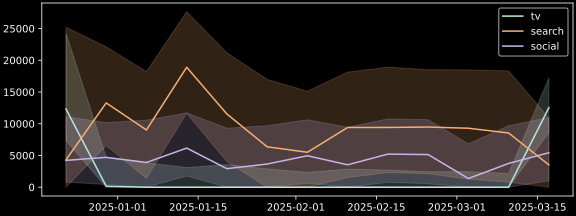

```{=html}
<script>
  // Hides the hero until landing.js plays the intro; a CSS fallback reveals it anyway.
  if (!matchMedia("(prefers-reduced-motion: reduce)").matches) document.documentElement.classList.add("mfm-intro");
</script>
<div class="mfm">

<!-- 1. Hero: one name, one line ------------------------------------------------ -->
<section class="mfm-hero" aria-labelledby="mfm-hero-title">
  <canvas class="mfm-hero__field" data-mfm="field" aria-hidden="true"></canvas>
  <div class="mfm-grain" aria-hidden="true"></div>
  <div class="mfm-hero__copy">
    <p class="mfm-hero__kicker">Marketing Foundation Models · by PyMC Labs</p>
    <!-- Now and then the first word glitches into "Bayesian" for a second. -->
    <h1 id="mfm-hero-title" class="mfm-hero__title" aria-label="PyMC MFM"><span class="mfm-hero__word mfm-glitch" data-mfm="glitch" data-text="PyMC" aria-hidden="true">PyMC</span> <span class="mfm-hero__word" aria-hidden="true">MFM</span></h1>
    <p class="mfm-hero__line">Train once, decompose many.</p>
    <div class="mfm-hero__actions">
      <a class="mfm-btn mfm-btn--primary" href="guide/index.html">Get started <span aria-hidden="true">→</span></a>
      <a class="mfm-btn mfm-btn--ghost" href="https://github.com/pymc-labs/pymc-mfm">GitHub</a>
    </div>
  </div>
  <a class="mfm-hero__scroll" href="#mfm-statement">Scroll to explore<span aria-hidden="true"></span></a>
</section>

<!-- 2. What it does, in one statement -------------------------------------------- -->
<section class="mfm-statement" id="mfm-statement">
  <p class="mfm-statement__text" data-mfm="statement">
    PyMC MFM trains neural networks on simulated marketing worlds. Hand one your weekly
    spend, controls and sales, and it returns posterior draws of every contribution, with the
    causal graph behind each draw. No MCMC. No refit.
  </p>
</section>

<!-- 3. The library at work: a notebook in an editor --------------------------------- -->
<section class="mfm-show" aria-labelledby="mfm-show-title">
  <header class="mfm-show__head mfm-reveal">
    <p class="mfm-eyebrow">The library</p>
    <h2 id="mfm-show-title">From a DataFrame to a posterior.</h2>
  </header>

  <figure class="mfm-stage mfm-reveal" aria-label="A Jupyter notebook in a code editor. It reads weekly sales with pandas, loads River 1.0, decomposes the last 13 weeks into 1,000 posterior draws, exports an ArviZ DataTree, summarises each channel's total contribution, and plots its distribution, the weekly contributions with 90% intervals and the stacked mean decomposition. Synthetic data; the outputs come from River 1.0.">
    <div class="mfm-stage__bg" aria-hidden="true"><i></i><i></i><i></i><i></i></div>
    <div class="mfm-grain" aria-hidden="true"></div>

    <div class="mfm-ide" data-mfm="notebook">
      <div class="mfm-ide__titlebar">
        <span class="mfm-ide__lights" aria-hidden="true"><i></i><i></i><i></i></span>
        <span class="mfm-ide__command"><svg viewBox="0 0 16 16" aria-hidden="true"><circle cx="7" cy="7" r="4.5"/><path d="M10.5 10.5 14 14"/></svg>pymc-mfm</span>
      </div>

      <div class="mfm-ide__body">
        <nav class="mfm-ide__activity" aria-hidden="true">
          <svg class="is-active" viewBox="0 0 24 24"><path d="M14 3H7a2 2 0 0 0-2 2v14a2 2 0 0 0 2 2h10a2 2 0 0 0 2-2V8z"/><path d="M14 3v5h5"/></svg>
          <svg viewBox="0 0 24 24"><circle cx="10.5" cy="10.5" r="6.5"/><path d="m15.5 15.5 5 5"/></svg>
          <svg viewBox="0 0 24 24"><circle cx="6" cy="5" r="2"/><circle cx="6" cy="19" r="2"/><circle cx="18" cy="9" r="2"/><path d="M6 7v10M18 11c0 4-6 3-11 7"/></svg>
          <svg viewBox="0 0 24 24"><path d="M7 4v16l13-8z"/></svg>
          <svg viewBox="0 0 24 24"><rect x="3" y="3" width="7" height="7"/><rect x="14" y="3" width="7" height="7"/><rect x="3" y="14" width="7" height="7"/><rect x="14" y="14" width="7" height="7"/></svg>
        </nav>

        <aside class="mfm-ide__explorer" aria-hidden="true">
          <p class="mfm-ide__explorer-title">Explorer</p>
          <ul>
            <li class="is-folder">pymc-mfm</li>
            <li class="is-folder is-l1">data</li>
            <li class="is-l2 is-csv">weekly_sales.csv</li>
            <li class="is-l1 is-ipynb is-active">quickstart.ipynb</li>
            <li class="is-l1 is-toml">pyproject.toml</li>
            <li class="is-l1 is-md">README.md</li>
          </ul>
        </aside>

        <div class="mfm-ide__editor">
          <div class="mfm-ide__tabs">
            <span class="mfm-ide__tab is-active"><i class="is-ipynb"></i>quickstart.ipynb</span>
            <span class="mfm-ide__tab"><i class="is-csv"></i>weekly_sales.csv</span>
          </div>
          <div class="mfm-ide__toolbar">
            <span>+ Code</span>
            <span>+ Markdown</span>
            <button class="mfm-ide__runall" type="button" data-mfm="run-all"><svg viewBox="0 0 16 16" aria-hidden="true"><path d="M4 2.5v11l9-5.5z"/></svg>Run All</button>
            <span class="mfm-ide__dim">Restart</span>
            <span class="mfm-ide__kernel">Python 3.13 (.venv)</span>
          </div>

          <div class="mfm-ide__cells" data-mfm="cells">
<div class="mfm-cell" data-duration="900">
  <div class="mfm-cell__gutter"><span class="mfm-cell__count">[1]</span></div>
  <div class="mfm-cell__main">
    <div class="mfm-cell__box">
      <span class="mfm-cell__bar" aria-hidden="true"></span>
<pre class="mfm-cell__code"><code><span class="k">import</span> <span class="m">arviz_stats</span> <span class="k">as</span> <span class="m">azs</span>
<span class="k">import</span> <span class="m">matplotlib.pyplot</span> <span class="k">as</span> <span class="m">plt</span>
<span class="k">import</span> <span class="m">numpy</span> <span class="k">as</span> <span class="m">np</span>
<span class="k">import</span> <span class="m">pandas</span> <span class="k">as</span> <span class="m">pd</span>
<span class="k">from</span> <span class="m">pymc_mfm</span> <span class="k">import</span> <span class="f">from_pretrained</span>

<span class="m">plt</span>.<span class="v">style</span>.<span class="f">use</span>(<span class="s">"dark_background"</span>)
<span class="m">plt</span>.<span class="v">rcParams</span>.<span class="f">update</span>({
    <span class="s">"axes.prop_cycle"</span>: <span class="m">plt</span>.<span class="f">cycler</span>(<span class="p">color</span><span class="o">=</span>[<span class="s">"#b4e7dd"</span>, <span class="s">"#f6ae72"</span>, <span class="s">"#c8b4e7"</span>]),
    <span class="s">"figure.constrained_layout.use"</span>: <span class="k">True</span>,
})

<span class="v">df</span> <span class="o">=</span> <span class="m">pd</span>.<span class="f">read_csv</span>(<span class="s">"data/weekly_sales.csv"</span>, <span class="p">parse_dates</span><span class="o">=</span>[<span class="s">"week"</span>])
<span class="v">df</span>.<span class="f">head</span>()</code></pre>
      <span class="mfm-cell__status" aria-hidden="true">✓</span>
    </div>
    <div class="mfm-cell__output">
      <table class="mfm-df">
        <thead><tr><th></th><th>week</th><th>tv</th><th>search</th><th>social</th><th>promo</th><th>sales</th></tr></thead>
        <tbody>
          <tr><th>0</th><td>2021-03-29</td><td>16300.0</td><td>1472.6</td><td>1215.5</td><td>0</td><td>52982.8</td></tr>
          <tr><th>1</th><td>2021-04-05</td><td>0.0</td><td>1357.7</td><td>763.9</td><td>0</td><td>39306.6</td></tr>
          <tr><th>2</th><td>2021-04-12</td><td>0.0</td><td>984.3</td><td>4291.7</td><td>0</td><td>48753.2</td></tr>
          <tr><th>3</th><td>2021-04-19</td><td>0.0</td><td>1329.7</td><td>4668.3</td><td>0</td><td>53429.6</td></tr>
          <tr><th>4</th><td>2021-04-26</td><td>0.0</td><td>1742.9</td><td>1149.4</td><td>0</td><td>45187.8</td></tr>
        </tbody>
      </table>
    </div>
  </div>
</div>

<div class="mfm-cell" data-duration="1600">
  <div class="mfm-cell__gutter"><span class="mfm-cell__count">[2]</span></div>
  <div class="mfm-cell__main">
    <div class="mfm-cell__box">
      <span class="mfm-cell__bar" aria-hidden="true"></span>
<pre class="mfm-cell__code"><code><span class="v">model</span> <span class="o">=</span> <span class="f">from_pretrained</span>(<span class="s">"pymc-labs/mfm"</span>, <span class="p">profile</span><span class="o">=</span><span class="s">"river-1"</span>).<span class="f">add_context</span>(
    <span class="v">df</span>[:<span class="n">-13</span>],
    <span class="p">date_column</span><span class="o">=</span><span class="s">"week"</span>,
    <span class="p">target_column</span><span class="o">=</span><span class="s">"sales"</span>,
    <span class="p">channel_columns</span><span class="o">=</span>[<span class="s">"tv"</span>, <span class="s">"search"</span>, <span class="s">"social"</span>],
    <span class="p">control_columns</span><span class="o">=</span>[<span class="s">"promo"</span>],
)</code></pre>
      <span class="mfm-cell__status" aria-hidden="true">✓</span>
    </div>
  </div>
</div>

<div class="mfm-cell" data-duration="1800">
  <div class="mfm-cell__gutter"><span class="mfm-cell__count">[3]</span></div>
  <div class="mfm-cell__main">
    <div class="mfm-cell__box">
      <span class="mfm-cell__bar" aria-hidden="true"></span>
<pre class="mfm-cell__code"><code><span class="v">query</span> <span class="o">=</span> <span class="v">model</span>.<span class="f">inference</span>(<span class="v">df</span>[<span class="n">-13</span>:], <span class="p">n_samples</span><span class="o">=</span><span class="n">1_000</span>)
<span class="v">query</span>.<span class="v">components</span>.<span class="v">shape</span>  <span class="c"># draws, weeks, components</span></code></pre>
      <span class="mfm-cell__status" aria-hidden="true">✓</span>
    </div>
    <div class="mfm-cell__output"><pre class="mfm-cell__text">(1000, 13, 18)</pre></div>
  </div>
</div>

<div class="mfm-cell" data-duration="1000">
  <div class="mfm-cell__gutter"><span class="mfm-cell__count">[4]</span></div>
  <div class="mfm-cell__main">
    <div class="mfm-cell__box">
      <span class="mfm-cell__bar" aria-hidden="true"></span>
<pre class="mfm-cell__code"><code><span class="v">idata</span> <span class="o">=</span> <span class="v">model</span>.<span class="f">build_idata</span>()  <span class="c"># ArviZ DataTree with context and query windows</span>
<span class="v">idata</span>[<span class="s">"query"</span>][<span class="s">"posterior"</span>]</code></pre>
      <span class="mfm-cell__status" aria-hidden="true">✓</span>
    </div>
    <div class="mfm-cell__output">
      <div class="mfm-xr">
        <p class="mfm-xr__head">xarray.DataTree <span>'posterior'</span></p>
        <p class="mfm-xr__sec">▸ Group: /query/posterior</p>
        <p class="mfm-xr__sec">▾ Dimensions: <span>(chain: 1, draw: 1000, date: 13, channel: 3, control: 1, edge: 18)</span></p>
        <p class="mfm-xr__sec">▸ Coordinates: <span>(6)</span></p>
        <p class="mfm-xr__sec">▾ Data variables:</p>
        <table class="mfm-xr__vars">
          <tr><th>channel_contribution</th><td>(chain, draw, date, channel)</td><td>float64</td><td>1.585e+04 ...</td></tr>
          <tr><th>control_contribution</th><td>(chain, draw, date, control)</td><td>float64</td><td>229.1 ...</td></tr>
          <tr><th>baseline</th><td>(chain, draw, date)</td><td>float64</td><td>2.608e+04 ...</td></tr>
          <tr><th>latent</th><td>(chain, draw, date)</td><td>float64</td><td>0.0 0.0 ...</td></tr>
          <tr><th>indirect_cc</th><td>(chain, draw, date)</td><td>float64</td><td>0.0 0.0 ...</td></tr>
          <tr><th>indirect_zc</th><td>(chain, draw, date)</td><td>float64</td><td>0.0 0.0 ...</td></tr>
          <tr><th>indirect_dc</th><td>(chain, draw, date)</td><td>float64</td><td>0.0 0.0 ...</td></tr>
          <tr><th>graph</th><td>(chain, draw, edge)</td><td>float32</td><td>1.0 1.0 ...</td></tr>
        </table>
        <p class="mfm-xr__sec">▸ Attributes: <span>(21)</span></p>
      </div>
    </div>
  </div>
</div>

<div class="mfm-cell" data-duration="700">
  <div class="mfm-cell__gutter"><span class="mfm-cell__count">[5]</span></div>
  <div class="mfm-cell__main">
    <div class="mfm-cell__box">
      <span class="mfm-cell__bar" aria-hidden="true"></span>
<pre class="mfm-cell__code"><code><span class="v">total</span> <span class="o">=</span> <span class="v">idata</span>[<span class="s">"query"</span>][<span class="s">"posterior"</span>][<span class="s">"channel_contribution"</span>].<span class="f">sum</span>(<span class="s">"date"</span>)
<span class="m">azs</span>.<span class="f">summary</span>(<span class="v">total</span>, <span class="p">kind</span><span class="o">=</span><span class="s">"stats"</span>)</code></pre>
      <span class="mfm-cell__status" aria-hidden="true">✓</span>
    </div>
    <div class="mfm-cell__output">
      <table class="mfm-df">
        <thead><tr><th></th><th>mean</th><th>sd</th><th>eti89_lb</th><th>eti89_ub</th></tr></thead>
        <tbody>
          <tr><th>channel_contribution[tv]</th><td>34000</td><td>11000</td><td>20000</td><td>52000</td></tr>
          <tr><th>channel_contribution[search]</th><td>130000</td><td>53000</td><td>46000</td><td>220000</td></tr>
          <tr><th>channel_contribution[social]</th><td>60000</td><td>36000</td><td>9100</td><td>120000</td></tr>
        </tbody>
      </table>
    </div>
  </div>
</div>

<div class="mfm-cell" data-duration="800">
  <div class="mfm-cell__gutter"><span class="mfm-cell__count">[6]</span></div>
  <div class="mfm-cell__main">
    <div class="mfm-cell__box">
      <span class="mfm-cell__bar" aria-hidden="true"></span>
<pre class="mfm-cell__code"><code><span class="v">fig</span>, <span class="v">ax</span> <span class="o">=</span> <span class="m">plt</span>.<span class="f">subplots</span>(<span class="p">figsize</span><span class="o">=</span>(<span class="n">8</span>, <span class="n">3</span>))
<span class="k">for</span> <span class="v">channel</span> <span class="k">in</span> <span class="v">total</span>.<span class="v">channel</span>.<span class="v">values</span>:
    <span class="v">ax</span>.<span class="f">hist</span>(<span class="v">total</span>.<span class="f">sel</span>(<span class="p">channel</span><span class="o">=</span><span class="v">channel</span>).<span class="v">values</span>.<span class="f">ravel</span>(), <span class="p">bins</span><span class="o">=</span><span class="n">60</span>, <span class="p">range</span><span class="o">=</span>(<span class="n">0</span>, <span class="n">3e5</span>),
            <span class="p">density</span><span class="o">=</span><span class="k">True</span>, <span class="p">histtype</span><span class="o">=</span><span class="s">"stepfilled"</span>, <span class="p">alpha</span><span class="o">=</span><span class="n">0.45</span>, <span class="p">label</span><span class="o">=</span><span class="v">channel</span>)
<span class="v">ax</span>.<span class="f">set_xlabel</span>(<span class="s">"contribution over the 13 weeks"</span>)
<span class="v">ax</span>.<span class="f">legend</span>()
<span class="m">plt</span>.<span class="f">show</span>()</code></pre>
      <span class="mfm-cell__status" aria-hidden="true">✓</span>
    </div>
    <div class="mfm-cell__output"></div>
  </div>
</div>

<div class="mfm-cell" data-duration="800">
  <div class="mfm-cell__gutter"><span class="mfm-cell__count">[7]</span></div>
  <div class="mfm-cell__main">
    <div class="mfm-cell__box">
      <span class="mfm-cell__bar" aria-hidden="true"></span>
<pre class="mfm-cell__code"><code><span class="v">names</span> <span class="o">=</span> <span class="t">list</span>(<span class="v">query</span>.<span class="v">component_names</span>)
<span class="v">fig</span>, <span class="v">ax</span> <span class="o">=</span> <span class="m">plt</span>.<span class="f">subplots</span>(<span class="p">figsize</span><span class="o">=</span>(<span class="n">8</span>, <span class="n">3</span>))
<span class="k">for</span> <span class="v">channel</span> <span class="k">in</span> [<span class="s">"tv"</span>, <span class="s">"search"</span>, <span class="s">"social"</span>]:
    <span class="v">draws</span> <span class="o">=</span> <span class="v">query</span>.<span class="v">components</span>[:, :, <span class="v">names</span>.<span class="f">index</span>(<span class="s">f"channel:</span>{<span class="v">channel</span>}<span class="s">"</span>)]
    <span class="v">low</span>, <span class="v">mid</span>, <span class="v">high</span> <span class="o">=</span> <span class="m">np</span>.<span class="f">quantile</span>(<span class="v">draws</span>, [<span class="n">0.05</span>, <span class="n">0.5</span>, <span class="n">0.95</span>], <span class="p">axis</span><span class="o">=</span><span class="n">0</span>)
    (<span class="v">line</span>,) <span class="o">=</span> <span class="v">ax</span>.<span class="f">plot</span>(<span class="v">query</span>.<span class="v">time</span>, <span class="v">mid</span>, <span class="p">label</span><span class="o">=</span><span class="v">channel</span>)
    <span class="v">ax</span>.<span class="f">fill_between</span>(<span class="v">query</span>.<span class="v">time</span>, <span class="v">low</span>, <span class="v">high</span>, <span class="p">color</span><span class="o">=</span><span class="v">line</span>.<span class="f">get_color</span>(), <span class="p">alpha</span><span class="o">=</span><span class="n">0.2</span>)
<span class="v">ax</span>.<span class="f">legend</span>()
<span class="m">plt</span>.<span class="f">show</span>()</code></pre>
      <span class="mfm-cell__status" aria-hidden="true">✓</span>
    </div>
    <div class="mfm-cell__output"></div>
  </div>
</div>

<div class="mfm-cell" data-duration="800">
  <div class="mfm-cell__gutter"><span class="mfm-cell__count">[8]</span></div>
  <div class="mfm-cell__main">
    <div class="mfm-cell__box">
      <span class="mfm-cell__bar" aria-hidden="true"></span>
<pre class="mfm-cell__code"><code><span class="v">mean</span> <span class="o">=</span> <span class="m">pd</span>.<span class="t">DataFrame</span>(<span class="v">query</span>.<span class="v">components</span>.<span class="f">mean</span>(<span class="p">axis</span><span class="o">=</span><span class="n">0</span>), <span class="p">index</span><span class="o">=</span><span class="v">query</span>.<span class="v">time</span>, <span class="p">columns</span><span class="o">=</span><span class="v">names</span>)
<span class="v">mean</span>[[<span class="s">"baseline"</span>, <span class="s">"channel:tv"</span>, <span class="s">"channel:search"</span>, <span class="s">"channel:social"</span>]].<span class="v">plot</span>.<span class="f">area</span>(
    <span class="p">figsize</span><span class="o">=</span>(<span class="n">8</span>, <span class="n">3</span>), <span class="p">color</span><span class="o">=</span>[<span class="s">"#9faae2"</span>, <span class="s">"#b4e7dd"</span>, <span class="s">"#f6ae72"</span>, <span class="s">"#c8b4e7"</span>]
)
<span class="m">plt</span>.<span class="f">show</span>()</code></pre>
      <span class="mfm-cell__status" aria-hidden="true">✓</span>
    </div>
    <div class="mfm-cell__output"></div>
  </div>
</div>
          </div>
        </div>
      </div>

      <div class="mfm-ide__statusbar" aria-hidden="true">
        <span>⎇ main</span>
        <span>⊗ 0 ⚠ 0</span>
        <span class="mfm-ide__spacer"></span>
        <span data-mfm="cell-of">Cell 8 of 8</span>
        <span>Python 3.13.9 ('.venv')</span>
      </div>
    </div>
    <!-- Cell outputs come from running these cells with River 1.0 (pinned revision, torch
         seed 0) on a synthetic weekly dataset; the figures are the matplotlib SVGs. -->
  </figure>

  <div class="mfm-show__install mfm-reveal">
    <div class="mfm-install">
      <span class="mfm-install__prompt" aria-hidden="true">$</span>
      <code class="mfm-install__cmd">pip install "pymc-mfm[hub,arviz,plot] @ git+https://github.com/pymc-labs/pymc-mfm.git"</code>
      <button class="mfm-install__copy" type="button" data-copy="pip install &quot;pymc-mfm[hub,arviz,plot] @ git+https://github.com/pymc-labs/pymc-mfm.git&quot;" aria-label="Copy install command">Copy</button>
    </div>
    <p class="mfm-show__note">Synthetic data; every output comes from River 1.0. <a href="guide/examples/river_1_quickstart.html">See the full quickstart →</a></p>
  </div>
</section>

<!-- 4. Why amortize: one word per screen --------------------------------------------- -->
<section class="mfm-chapters" data-mfm="chapters" aria-label="Why amortize">
  <div class="mfm-chapters__track">
    <article class="mfm-chapter" style="--tone: 180, 231, 221">
      <p class="mfm-chapter__index">01 / 03</p>
      <h2 class="mfm-chapter__word">Amortized.</h2>
      <p class="mfm-chapter__line">Training is paid once, on simulated worlds with known answers. A new dataset is
        context, not a new fit: a thousand posterior draws in seconds, on a CPU.</p>
    </article>
    <article class="mfm-chapter" style="--tone: 246, 174, 114">
      <p class="mfm-chapter__index">02 / 03</p>
      <h2 class="mfm-chapter__word">Causal.</h2>
      <p class="mfm-chapter__line">Every draw carries the causal graph it was sampled with, over channels, controls and
        latent demand. Average over graphs, take the most frequent one, or fix your own.</p>
    </article>
    <article class="mfm-chapter" style="--tone: 200, 180, 231">
      <p class="mfm-chapter__index">03 / 03</p>
      <h2 class="mfm-chapter__word">Bayesian.</h2>
      <p class="mfm-chapter__line">Draws, not point estimates: each contribution in outcome units with its uncertainty,
        exported as an ArviZ DataTree for the rest of your PyMC workflow.</p>
    </article>
  </div>
</section>

<!-- 5. Latest model -------------------------------------------------------------- -->
<section class="mfm-section mfm-reveal" aria-labelledby="mfm-model-title">
  <div class="mfm-release">
    <div class="mfm-release__name">
      <p class="mfm-eyebrow">Latest model</p>
      <h2 id="mfm-model-title">River 1.0</h2>
    </div>
    <div class="mfm-release__body">
      <p>PyMC Labs' first published network: 2.4M parameters, any number of channels, posterior
        draws in seconds on a CPU.</p>
      <p class="mfm-release__links">
        <a href="models/river-1/index.html">Release notes <span aria-hidden="true">→</span></a>
        <a href="https://huggingface.co/pymc-labs/mfm">Hugging Face <span aria-hidden="true">↗</span></a>
      </p>
    </div>
  </div>
</section>

<!-- 6. Explore ----------------------------------------------------------------- -->
<section class="mfm-section mfm-reveal" aria-label="Explore the documentation">
  <nav class="mfm-explore">
    <a href="guide/index.html"><span class="mfm-explore__title">Guide <span aria-hidden="true">→</span></span><span class="mfm-explore__text">Install, concepts and worked notebooks.</span></a>
    <a href="reference/index.html"><span class="mfm-explore__title">API <span aria-hidden="true">→</span></span><span class="mfm-explore__text">Every public class and function, from the docstrings.</span></a>
    <a href="models/index.html"><span class="mfm-explore__title">Models <span aria-hidden="true">→</span></span><span class="mfm-explore__text">Trained networks and their release notes.</span></a>
    <a href="blog/index.html"><span class="mfm-explore__title">Blog <span aria-hidden="true">→</span></span><span class="mfm-explore__text">Methods and engineering notes from the team.</span></a>
  </nav>
</section>

<section class="mfm-outro mfm-reveal">
  <p>From the team behind <a href="https://www.pymc-labs.com/open-source">PyMC, PyMC-Marketing and CausalPy</a>.</p>
  <a class="mfm-btn mfm-btn--ghost" href="https://www.pymc-labs.com">Visit pymc-labs.com <span aria-hidden="true">↗</span></a>
</section>

</div>
<!-- GSAP 3.15.1 (free standard license) for the intro and scroll scenes. Without it the page
     still works: landing.js falls back to static layouts and CSS reveals. -->
<script src="https://cdn.jsdelivr.net/npm/gsap@3.15.1/dist/gsap.min.js" integrity="sha384-3vCAhD+a3BOliP3QqjQINn6ZWiZxoqu0WFxX5ZQZgqekDZuSb1mJBrrLMmu94H8f" crossorigin="anonymous" defer></script>
<script src="https://cdn.jsdelivr.net/npm/gsap@3.15.1/dist/ScrollTrigger.min.js" integrity="sha384-H2WL1iy/jKQQ7MTHU2hskZKNHTYWWD/KgKE1vCNnaWY8An2ESTh23KN/fTp8XS3j" crossorigin="anonymous" defer></script>
<script src="https://cdn.jsdelivr.net/npm/gsap@3.15.1/dist/SplitText.min.js" integrity="sha384-e98MX/fxZrUXA/6T+aCptryLfHgR2FpEmWxDbbPloHT0Qg79dEXKdLJ/iwD2lzxs" crossorigin="anonymous" defer></script>
<script src="assets/js/landing.js" defer></script>
```
